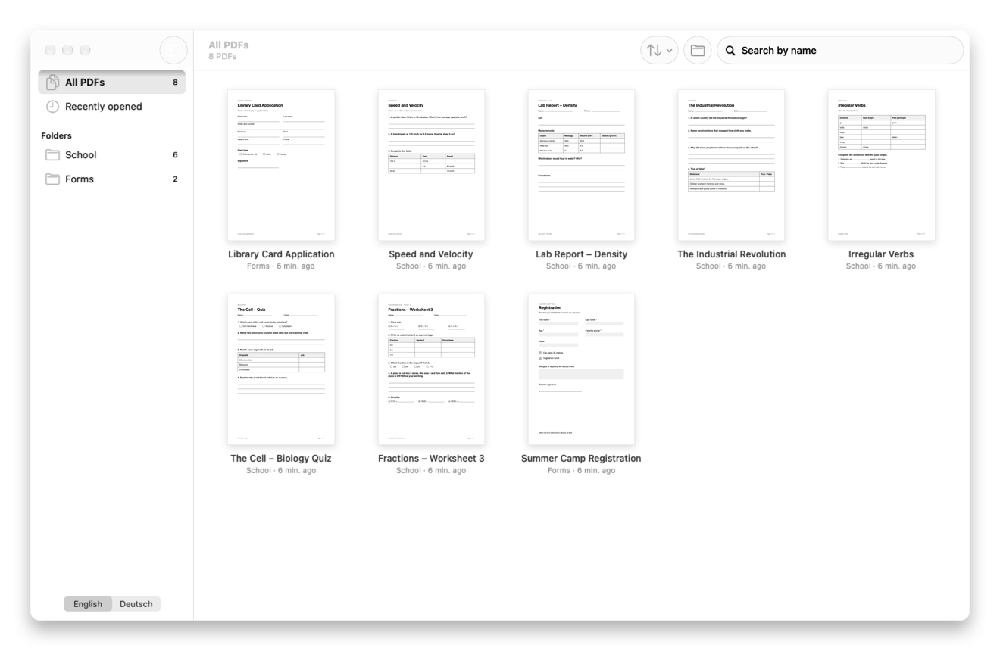

# Blanko

A Mac app for filling in PDFs, with an assistant that writes the answers **into the PDF**, not
only into a chat.

- **Library**: every PDF on the Mac in one grid (Spotlight plus Desktop, Documents, Downloads and
  iCloud Drive), with search, folders and "recently opened".
- **Reader**: opens a PDF like a browser does. Form fields can be clicked and filled in
  (text, checkboxes, radio buttons, lists, Tab to the next field). The text tool writes anywhere
  on a page that has no fields; such text can be moved, resized, edited and deleted.
- **Assistant**: "Solve this page" works out the tasks and puts the answers where they belong:
  into form fields, onto answer lines and blanks, into table cells, an X into the right box.
  Each answer has an Undo. "Solve the whole PDF" goes through all pages.
- **Save** (⌘S) writes everything into the PDF as ordinary form values and text annotations, so
  any other viewer shows it too.

English, with German to choose inside the app.




## Install

```sh
curl --proto '=https' --tlsv1.2 -fsSL https://github.com/KorelUyar/blanko/releases/latest/download/install.sh | zsh
```

This downloads the latest release and puts Blanko in Applications. Blanko is not notarised by
Apple, so a copy downloaded with a browser has to be allowed once under System Settings, Privacy
& Security, Open Anyway. Needs macOS 14 or later.

## The assistant needs one of these

- **Claude Code** installed and signed in on the Mac: nothing to set up, Blanko uses that login.
- or an **Anthropic API key**: "Use an API key…" in the chat, or Settings (⌘,). It is stored in
  the keychain and sent only to `api.anthropic.com`.

With both set up, one stands in for the other: when the chosen one cannot sign in (an expired
Claude Code login, a refused key), the request goes to the other one. A Claude Code sign-in that
fails is tried once more before that, since another Claude Code on the Mac may just be renewing
it. The chat then offers "Sign in to Claude Code" (opens Terminal with `claude auth login`),
"Use an API key…" and "Try again".

The model is Claude Opus 5.5 unless changed in Settings.

## What leaves your Mac

Blanko has no account and no server of its own. When you ask the assistant, the page you are on
(two pictures of it and its text) and the text of the document's other pages go to Claude,
through Claude Code or the API, and nowhere else. Chats are kept on the Mac, in
`~/Library/Application Support/Blanko/chats`. The assistant only gets the document: Claude Code
runs without any tools, in an empty folder of its own, so text in a PDF cannot make it read or
change files.

## Build

```sh
scripts/build-app.sh --install     # builds dist/Blanko.app (universal) and copies it to /Applications
```

Needs Xcode or the Command Line Tools. No dependencies. More in [DEV.md](DEV.md).

## Licence

MIT, see [LICENSE](LICENSE).
