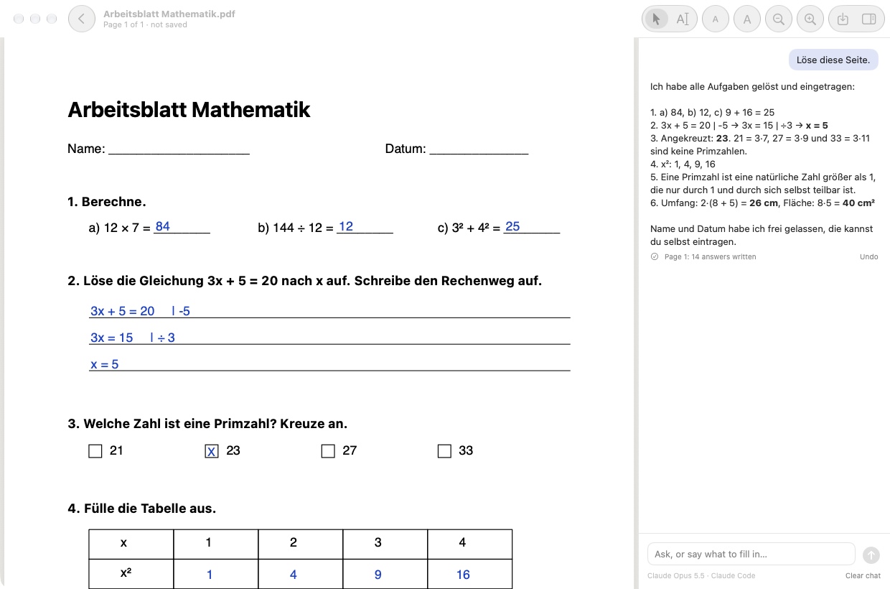

# Blanko

A Mac app for filling in PDFs, with an assistant that writes the answers **into the PDF**, not
only into a chat.

- **Library**: every PDF on the Mac in one grid (Spotlight plus Desktop, Documents, Downloads and
  iCloud Drive), with search, folders and "recently opened".
- **Reader**: opens a PDF like a browser does. Form fields can be clicked and filled in
  (text, checkboxes, radio buttons, lists, Tab to the next field). The text tool writes anywhere
  on a page that has no fields; such text can be moved, resized, edited and deleted.
- **Assistant**: "Solve this page" works out the tasks and puts the answers where they belong:
  into form fields, onto answer lines and blanks, into table cells, an X into the right box.
  Each answer has an Undo. "Solve the whole PDF" goes through all pages.
- **Save** (⌘S) writes everything into the PDF as ordinary form values and text annotations, so
  any other viewer shows it too.




## The assistant needs one of these

- **Claude Code** installed and signed in on the Mac: nothing to set up, Blanko uses that login.
- or an **Anthropic API key**, entered under Settings (⌘,). It is stored in the keychain.

The model is Claude Opus 5.5 unless changed in Settings.

## Build and install

```sh
scripts/build-app.sh --install     # builds dist/Blanko.app (universal) and copies it to /Applications
```

Needs Xcode or the Command Line Tools. The app is signed ad hoc; there is no notarisation.
More in [DEV.md](DEV.md).
